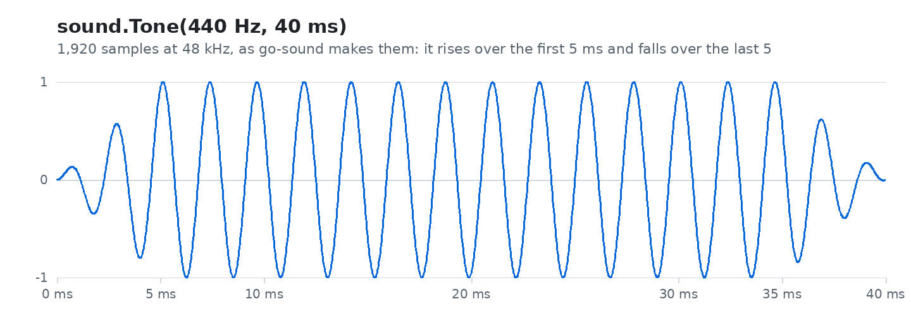
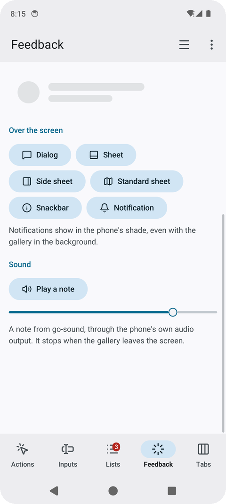
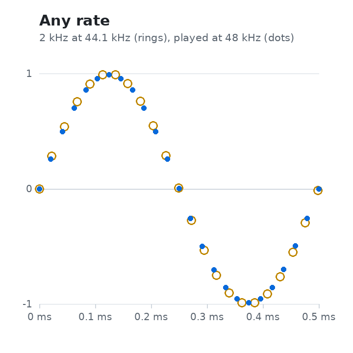
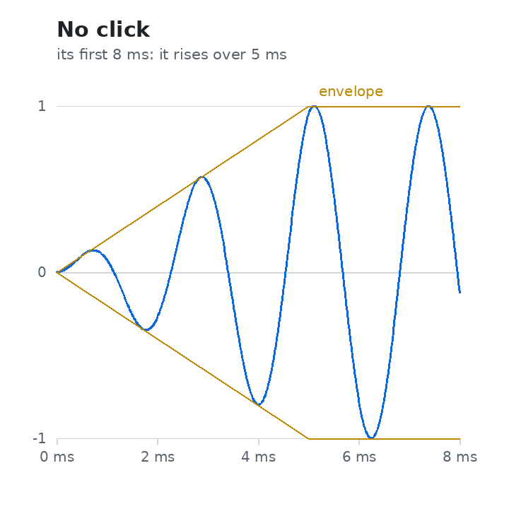
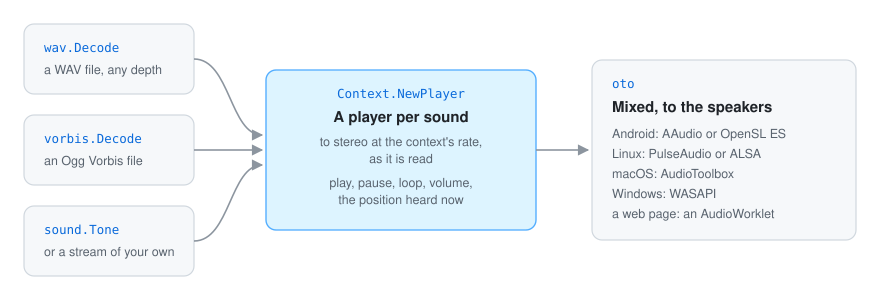

<div align="center">

# Go sound

**Sound for Go programs, on phones, desktops and the web.** Effects, music and, soon, the sound of
films: players mixed and sent to the speakers through each system's own audio, with WAV and Ogg
Vorbis read in Go. It needs neither [go-renderer](https://github.com/akrck02/go-renderer) nor
[go-ui](https://github.com/akrck02/go-ui), and plays beside them.

[](go.mod)


[](LICENSE)

</div>

> **Note:** this project was written with an AI assistant and is pending thorough review. See the [AI disclosure](#-ai-disclosure).

## 🤖 AI disclosure

I write most of my code by hand, so I want to be clear about this project: **it was written by an
AI assistant (Claude, by Anthropic) under my direction, in October 2026.** I decided what to build
and how it should behave; the code, the tests and the documentation were written by the AI. Every
commit made this way carries a `Co-Authored-By: Claude` line.

**Status: pending thorough review.** The code compiles and its tests pass, and it was heard on a
phone (on the Android 14 emulator the system reports it playing, pausing in the background and
playing again), but I have not yet reviewed it line by line. Treat it as a working draft, not as code I vouch for.

> ⚠️ **Warning:** an educational experiment, **not suitable for production use**. APIs will break.

---

<p align="center">
<picture>
  <source media="(prefers-color-scheme: dark)" srcset="docs/images/hero-dark.png">
  
</picture>
</p>

<p align="center"><sub>A 440 Hz <code>sound.Tone</code>, drawn from the 1,920 samples go-sound makes for it.</sub></p>

## ✨ What it looks like

<table>
<tr>
<th width="33%">On a phone</th>
<th width="33%">Any rate</th>
<th width="33%">No clicks</th>
</tr>
<tr>
<td>
<picture>
  <source media="(prefers-color-scheme: dark)" srcset="docs/images/gallery-dark.png">
  
</picture>
</td>
<td>
<picture>
  <source media="(prefers-color-scheme: dark)" srcset="docs/images/rates-dark.png">
  
</picture>
</td>
<td>
<picture>
  <source media="(prefers-color-scheme: dark)" srcset="docs/images/fade-dark.png">
  
</picture>
</td>
</tr>
<tr>
<td>go-ui-android's gallery plays a note through AAudio, and goes quiet when it leaves the screen.</td>
<td>A sound of any rate and channels plays: it is turned into stereo at the context's rate as it is read.</td>
<td>A tone rises and falls over a few milliseconds, so it starts and stops without a click.</td>
</tr>
</table>

## 🚀 Quick start

```go
context, err := sound.NewContext(sound.Options{Name: "Lighthouses"})
…
//go:embed foghorn.ogg
var foghorn []byte

stream, err := vorbis.Decode(bytes.NewReader(foghorn))
player, err := context.NewPlayer(stream)
player.SetLoop(true)
player.Play()
```

On a phone, stop the sound when the program leaves the screen and play it again when it comes back.
With go-ui, `window.Options.Hidden` and `Shown` call `context.Suspend` and `context.Resume`.
[More on using it →](docs/using.md)

## 🔍 How it works

<p align="center">
  
</p>

Every stream is converted as it is read and played by [oto](https://github.com/ebitengine/oto),
which mixes the players and talks to each system: AAudio or OpenSL ES on Android, PulseAudio or ALSA
on Linux, AudioToolbox, WASAPI and an AudioWorklet in a browser. [More on the design →](docs/design.md)

## 📚 Documentation

| | |
|---|---|
| [Using go-sound](docs/using.md) | A context, players, looping, volume, the position heard, phones going to the background. |
| [Sound files](docs/formats.md) | WAV and Ogg Vorbis, and which to choose. |
| [The design](docs/design.md) | Why a repository of its own, why oto, how a film's pictures will follow its sound. |
| [Roadmap](docs/roadmap.md) | What is left, step by step: the sound of films, audio focus, more formats. |

## Licence

MIT, see [LICENSE](LICENSE).
