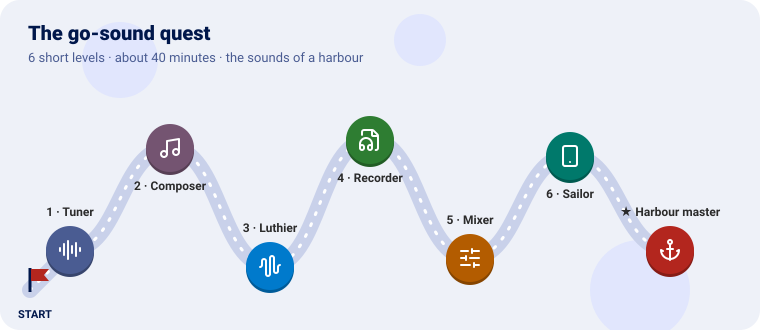
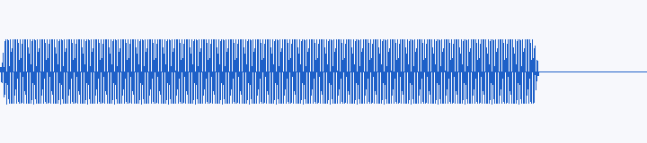
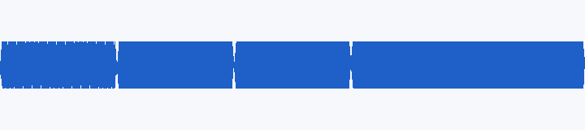
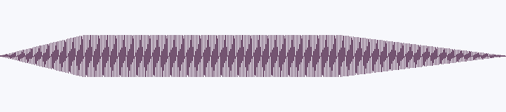
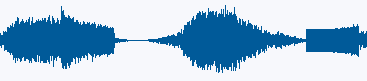
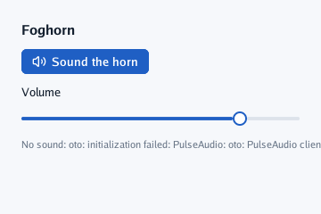
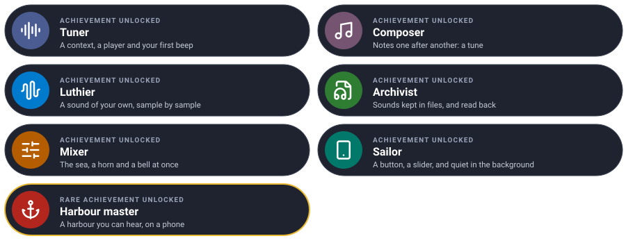

# The go-sound quest

Make a harbour you can hear, one level at a time. Each level teaches one piece of go-sound and
ends with a new sound.



We will build the sounds of a **harbour**: a beep, a tune, a foghorn made sample by sample, a file
to keep it in, the sea and a bell mixed together, and an app with a button to sound the horn,
which goes quiet when a phone puts it in the background.

---

Every level has the same shape: **the idea** (explained with something from everyday life), **the
code**, a **checkpoint** to know it works, and an optional **bonus**. Each level leaves you with a
program that plays.

---

## Before you start

You need Go 1.25 or later and speakers. Make a folder for the quest beside a copy of go-sound:

```sh
git clone https://github.com/akrck02/go-sound
mkdir harbour && cd harbour
go mod init example.com/harbour
go mod edit -require github.com/akrck02/go-sound@v0.0.0 -replace github.com/akrck02/go-sound=../go-sound
```

Each level is a `main.go` (and sometimes a second file) in this folder. Run it with:

```sh
go mod tidy   # the first time
go run .
```

> 🔇 **No sound?** go-sound never stops your program for want of speakers: `context.Err()` says
> why it is silent. Every level prints it. On Linux you need PulseAudio, PipeWire or ALSA running;
> see [Troubleshooting](#troubleshooting).

The pictures of each checkpoint are the waves the code makes, drawn from its samples: what you
should hear.

---

## Level 1 · The Tuner

| Mission | Pieces | Time |
|---|---|---|
| Open the speakers and play a beep | `NewContext`, `NewPlayer`, `Tone` | 5 min |

#### The idea

Think of a **record player**. The **context** is the amplifier and the speakers: a program has
exactly one, and switches it on once. A **player** is a turntable on it, and the **stream** is the
record it plays. You can have many turntables on one amplifier, playing at once.

`sound.Tone` is the simplest record of all: one pure note.

#### Build it

```go
package main

import (
	"log"
	"time"

	sound "github.com/akrck02/go-sound"
)

func main() {
	context, err := sound.NewContext(sound.Options{Name: "Foghorn"})
	if err != nil {
		log.Fatal(err)
	}
	<-context.Ready() // at once on a computer; after the first touch in a web page

	beep, err := context.NewPlayer(sound.Tone(440, 500*time.Millisecond, 0.5))
	if err != nil {
		log.Fatal(err)
	}
	beep.Play()

	time.Sleep(time.Second) // the program must live while the sound plays
	if err := context.Err(); err != nil {
		log.Print("no sound: ", err)
	}
}
```

`Play` returns at once and the sound goes on by itself, so the program sleeps a second: if `main`
returned, the sound would stop with it.

#### Checkpoint

You hear a clean **A** (440 vibrations a second) for half a second, with no click at its start or
end: a tone rises and falls over a few milliseconds.



#### Bonus (optional): higher, quieter

Play an **A** one octave up (twice the frequency) at a quarter of the volume.

<details>
<summary>🔓 Show the solution</summary>

<pre><code>beep, err := context.NewPlayer(sound.Tone(880, 500*time.Millisecond, 0.25))</code></pre>

Or keep the tone and turn the player down: `beep.SetVolume(0.5)`.

</details>


Learn more: [Using go-sound](3-using-go-sound.md#a-context)

---

## Level 2 · The Composer

| Mission | Pieces | Time |
|---|---|---|
| Notes one after another | `IsPlaying`, `Close` | 5 min |

#### The idea

A tune is a **queue at a bakery**: each note waits for the one before it to finish. A player
tells you whether it is still playing with `IsPlaying`; when it says no, the next note is served.

#### Build it

```go
package main

import (
	"log"
	"time"

	sound "github.com/akrck02/go-sound"
)

// note is a pitch and how long it lasts.
type note struct {
	frequency float64
	length    time.Duration
}

func main() {
	context, err := sound.NewContext(sound.Options{Name: "Foghorn"})
	if err != nil {
		log.Fatal(err)
	}
	<-context.Ready()

	tune := []note{{392, 300 * time.Millisecond}, {440, 300 * time.Millisecond}, {494, 300 * time.Millisecond}, {587, 600 * time.Millisecond}}
	for _, step := range tune {
		player, err := context.NewPlayer(sound.Tone(step.frequency, step.length, 0.4))
		if err != nil {
			log.Fatal(err)
		}
		player.Play()
		for player.IsPlaying() { // wait for the note to end
			time.Sleep(10 * time.Millisecond)
		}
		player.Close()
	}
}
```

`Close` lets go of a player you will not use again.

#### Checkpoint

Four notes going up, **G A B D**, the last one longer.



#### Bonus (optional): a chord

Play the first three notes **at the same time** instead.

<details>
<summary>🔓 Show the solution</summary>

<pre><code>for _, frequency := range []float64{392, 494, 587} {
	player, _ := context.NewPlayer(sound.Tone(frequency, time.Second, 0.25))
	player.Play() // no waiting: three turntables on one amplifier
}
time.Sleep(1500 * time.Millisecond)</code></pre>

Three players play together: the context mixes them. Keep each volume low, or they add up past
what the speakers take.

</details>


---

## Level 3 · The Luthier

| Mission | Pieces | Time |
|---|---|---|
| A foghorn, made sample by sample | `Stream`, `Format`, `Rewinder`, `SetLoop` | 10 min |

#### The idea

A luthier makes instruments by hand. Here you make one in code: a **stream** is anything that can
answer two questions — *how is your sound written?* (`Format`) and *give me the next samples*
(`Read`). A sample is a number from −1 to 1: how far the speaker's cone is pushed at that instant.
48,000 of them make a second of sound.

A foghorn is a low note with overtones (which make it rough), swelling in and fading out.

#### Build it

`foghorn.go`:

```go
package main

import (
	"io"
	"math"

	sound "github.com/akrck02/go-sound"
)

// foghorn is a stream of its own: a low, rough note that swells and fades, as a foghorn does.
type foghorn struct {
	rate     int     // frames a second
	frames   int     // how long it lasts, in frames
	position int     // the next frame to read
	pitch    float64 // its note, in hertz
}

func newFoghorn(rate int, seconds, pitch float64) *foghorn {
	return &foghorn{rate: rate, frames: int(seconds * float64(rate)), pitch: pitch}
}

// Format says the samples are mono, at the foghorn's rate: the context turns them into stereo.
func (horn *foghorn) Format() sound.Format { return sound.Format{SampleRate: horn.rate, Channels: 1} }

// Read writes as many frames as fit, and io.EOF once the horn has sounded.
func (horn *foghorn) Read(samples []float32) (int, error) {
	written := 0
	for written < len(samples) && horn.position < horn.frames {
		seconds := float64(horn.position) / float64(horn.rate)
		phase := 2 * math.Pi * horn.pitch * seconds
		// a fundamental and two overtones make it rough
		wave := math.Sin(phase) + 0.5*math.Sin(2*phase) + 0.25*math.Sin(3*phase)
		samples[written] = float32(0.3 * wave * horn.envelope(seconds))
		written++
		horn.position++
	}
	if horn.position >= horn.frames {
		return written, io.EOF
	}
	return written, nil
}

// envelope is how loud the horn is at a moment: it swells over half a second and fades over one.
func (horn *foghorn) envelope(seconds float64) float64 {
	length := float64(horn.frames) / float64(horn.rate)
	return math.Min(1, math.Min(seconds/0.5, (length-seconds)/1.0))
}

// Rewind starts it again, so a player can loop it.
func (horn *foghorn) Rewind() error {
	horn.position = 0
	return nil
}
```

`main.go`:

```go
package main

import (
	"log"
	"time"

	sound "github.com/akrck02/go-sound"
)

func main() {
	context, err := sound.NewContext(sound.Options{Name: "Foghorn"})
	if err != nil {
		log.Fatal(err)
	}
	<-context.Ready()

	horn, err := context.NewPlayer(newFoghorn(context.SampleRate(), 3, 110))
	if err != nil {
		log.Fatal(err)
	}
	horn.SetLoop(true) // over and over: it rewinds at its end
	horn.Play()
	time.Sleep(10 * time.Second)
}
```

The horn is **mono** (one channel) and the context plays stereo at its own rate: it converts the
stream as it reads it, so a stream can be written in whatever format is simplest.

#### Checkpoint

A deep, buzzing horn that swells for half a second, holds, and fades, every three seconds.



#### Bonus (optional): a sadder horn

Make it a **minor third** lower, and slower to fade.

<details>
<summary>🔓 Show the solution</summary>

A minor third down is a pitch about 0.84 times as high: `newFoghorn(rate, 4, 110*0.84)`, and in
`envelope`, divide `(length-seconds)` by `2.0` instead of `1.0`.

</details>


Learn more: [Streams](3-using-go-sound.md#streams)

---

## Level 4 · The Recorder

| Mission | Pieces | Time |
|---|---|---|
| Keep the horn in a WAV file and play it back | `wav.Decode` | 8 min |

#### The idea

A **WAV file** is a box of samples with a label on the lid: the label (the *header*) says how fast
and how many channels; the rest is the samples one after another. Programs ship their sounds as
files and **decode** them back into streams.

#### Build it

Keep `foghorn.go`. Add `wavfile.go`, which writes any stream into a box:

```go
package main

import (
	"encoding/binary"
	"errors"
	"io"
	"math"
	"os"

	sound "github.com/akrck02/go-sound"
)

// saveWAV writes a whole stream into a WAV file of 16-bit samples: a short header, then the
// samples one after another.
func saveWAV(path string, stream sound.Stream) error {
	format := stream.Format()
	var samples []int16
	buffer := make([]float32, 4096*format.Channels)
	for {
		count, err := stream.Read(buffer)
		for _, sample := range buffer[:count] {
			samples = append(samples, int16(math.Max(-1, math.Min(1, float64(sample)))*32767))
		}
		if errors.Is(err, io.EOF) {
			break
		}
		if err != nil {
			return err
		}
	}
	file, err := os.Create(path)
	if err != nil {
		return err
	}
	defer file.Close()
	dataSize := uint32(len(samples) * 2)
	header := []any{
		[4]byte{'R', 'I', 'F', 'F'}, 36 + dataSize, [4]byte{'W', 'A', 'V', 'E'},
		[4]byte{'f', 'm', 't', ' '}, uint32(16), uint16(1), uint16(format.Channels), uint32(format.SampleRate),
		uint32(format.SampleRate * format.Channels * 2), uint16(format.Channels * 2), uint16(16),
		[4]byte{'d', 'a', 't', 'a'}, dataSize,
	}
	for _, field := range header {
		if err := binary.Write(file, binary.LittleEndian, field); err != nil {
			return err
		}
	}
	return binary.Write(file, binary.LittleEndian, samples)
}
```

And `main.go`:

```go
package main

import (
	"bytes"
	"log"
	"os"
	"time"

	sound "github.com/akrck02/go-sound"
	"github.com/akrck02/go-sound/wav"
)

func main() {
	// keep the foghorn in a file, once
	if err := saveWAV("foghorn.wav", newFoghorn(22050, 3, 110)); err != nil {
		log.Fatal(err)
	}

	// read it back, as a program reads the sounds it ships with
	file, err := os.ReadFile("foghorn.wav")
	if err != nil {
		log.Fatal(err)
	}
	stream, err := wav.Decode(bytes.NewReader(file))
	if err != nil {
		log.Fatal(err)
	}
	log.Printf("%d frames a second, %d channel(s)", stream.Format().SampleRate, stream.Format().Channels)

	context, err := sound.NewContext(sound.Options{Name: "Foghorn"})
	if err != nil {
		log.Fatal(err)
	}
	<-context.Ready()
	player, err := context.NewPlayer(stream)
	if err != nil {
		log.Fatal(err)
	}
	player.SetVolume(0.5)
	player.Play()
	time.Sleep(4 * time.Second)
}
```

#### Checkpoint

A file `foghorn.wav` of about 130 KB appears in the folder, the program prints
`22050 frames a second, 1 channel(s)`, and you hear the horn at half the volume. Open the file in
any audio player: it is the same horn.

#### Bonus (optional): ship it inside the program

Programs for phones and web pages have no files beside them. Embed the WAV.

<details>
<summary>🔓 Show the solution</summary>

<pre><code>import _ "embed"

//go:embed foghorn.wav
var foghornFile []byte

stream, err := wav.Decode(bytes.NewReader(foghornFile))</code></pre>

A `bytes.Reader` can seek, so the stream can be rewound and looped. For music, Ogg Vorbis files
are ten times smaller: `vorbis.Decode` reads them the same way ([sound files](4-sound-files.md)).

</details>


Learn more: [Sound files](4-sound-files.md)

---

## Level 5 · The Mixer

| Mission | Pieces | Time |
|---|---|---|
| The sea, a horn and a bell at the same time | several players, `SetVolume`, `Position` | 8 min |

#### The idea

A **mixing desk** has a fader for each instrument. Each player is one: its own volume, its own
start and stop, and the context adds them all into one sound for the speakers.

The sea is noise, smoothed so it rumbles instead of hissing, rising and falling every six seconds.
It **never ends**, so it needs no rewinding to loop.

#### Build it

Keep `foghorn.go`. Add `sea.go`:

```go
package main

import (
	"math"
	"math/rand/v2"

	sound "github.com/akrck02/go-sound"
)

// sea is endless noise that rises and falls like waves: it never ends, so it needs no Rewind.
type sea struct {
	rate     int
	position int
	random   *rand.Rand
	last     float64 // the noise is smoothed, so it rumbles instead of hissing
}

func newSea(rate int) *sea { return &sea{rate: rate, random: rand.New(rand.NewPCG(1, 2))} }

func (water *sea) Format() sound.Format { return sound.Format{SampleRate: water.rate, Channels: 1} }

func (water *sea) Read(samples []float32) (int, error) {
	for index := range samples {
		seconds := float64(water.position) / float64(water.rate)
		swell := 0.5 + 0.5*math.Sin(2*math.Pi*seconds/6) // a wave every six seconds
		water.last += 0.05 * (water.random.Float64()*2 - 1 - water.last)
		samples[index] = float32(water.last * swell * 2)
		water.position++
	}
	return len(samples), nil
}
```

`main.go`:

```go
package main

import (
	"fmt"
	"log"
	"time"

	sound "github.com/akrck02/go-sound"
)

func main() {
	context, err := sound.NewContext(sound.Options{Name: "Harbour"})
	if err != nil {
		log.Fatal(err)
	}
	<-context.Ready()
	rate := context.SampleRate()

	waves, _ := context.NewPlayer(newSea(rate)) // three players: the context mixes them
	horn, _ := context.NewPlayer(newFoghorn(rate, 3, 110))
	bell, _ := context.NewPlayer(sound.Tone(1320, 800*time.Millisecond, 0.3))

	waves.SetVolume(0.6)
	waves.Play()
	for second := 0; second < 12; second++ {
		if second%6 == 0 {
			horn.Play() // a horn every six seconds; Play starts it again once it has ended
		}
		if second%4 == 2 {
			bell.Play()
		}
		fmt.Printf("%2d s  horn at %v\n", second, horn.Position().Round(100*time.Millisecond))
		time.Sleep(time.Second)
	}
}
```

`Position` tells how far into a sound what you hear **now** is: what was read, minus what still
waits in the system's buffers. A film's pictures follow it to stay in time with its sound.

#### Checkpoint

Waves come and go; a horn sounds at 0 and 6 seconds, a bell at 2, 6 and 10. The terminal counts
the seconds and the horn's position.



#### Bonus (optional): a storm

Make the waves come twice as often and the sea louder, but keep the bell quiet.

<details>
<summary>🔓 Show the solution</summary>

In `sea.go`, `seconds/3` instead of `seconds/6`; in `main.go`, `waves.SetVolume(1)` and
`bell.SetVolume(0.5)`.

</details>


---

## Level 6 · The Sailor

| Mission | Pieces | Time |
|---|---|---|
| A button to sound the horn, and quiet in the background | go-ui, `Suspend`, `Resume` | 8 min |

#### The idea

A polite app is a **sailor who stops whistling when he goes ashore**: when the phone puts it in the
background (another app, the screen locked), it goes quiet, and plays again when it comes back.
go-ui's window tells you both moments: `Options.Hidden` and `Options.Shown`.

#### Build it

This level needs [go-ui](https://github.com/akrck02/go-ui) and go-renderer beside go-sound
([go-ui's Get started](https://github.com/akrck02/go-ui/blob/main/docs/2-get-started.md)):

```sh
git clone https://github.com/akrck02/go-renderer ../go-renderer
git clone https://github.com/akrck02/go-ui ../go-ui
go mod edit -require github.com/akrck02/go-ui@v0.0.0 -replace github.com/akrck02/go-ui=../go-ui
go mod edit -require github.com/akrck02/go-renderer@v0.0.0 -replace github.com/akrck02/go-renderer=../go-renderer
```

Keep `foghorn.go`, and replace `main.go`:

```go
package main

import (
	"flag"
	"log"
	"time"

	sound "github.com/akrck02/go-sound"
	ui "github.com/akrck02/go-ui"
	"github.com/akrck02/go-ui/window"
)

func main() {
	options := window.Options{Title: "Foghorn"}
	options.RegisterFlags(flag.CommandLine)
	flag.Parse()

	context, err := sound.NewContext(sound.Options{Name: "Foghorn"})
	if err != nil {
		log.Fatal(err)
	}
	horn, err := context.NewPlayer(newFoghorn(context.SampleRate(), 3, 110))
	if err != nil {
		log.Fatal(err)
	}
	volume := float32(0.8)

	// on a phone: quiet in the background, and back when the app returns
	options.Hidden = func() { context.Suspend() }
	options.Shown = func() { context.Resume() }

	err = window.Run(options, func(screen *ui.Context) {
		screen.Box(ui.Layout{Direction: ui.Vertical, Padding: ui.Pad(24), Gap: 12, Width: ui.Grow()}, func() {
			screen.Heading("Foghorn")
			if screen.PrimaryIconButton("volume-2", "Sound the horn") {
				horn.Rewind()
				horn.Play()
			}
			screen.Label("Volume")
			if screen.Slider("volume", &volume, 0, 1) {
				horn.SetVolume(float64(volume))
			}
			if horn.IsPlaying() {
				screen.Caption("Sounding…")
				screen.RequestFrame(100 * time.Millisecond) // look again soon: the sound ends on its own
			}
			if err := context.Err(); err != nil {
				screen.Caption("No sound: " + err.Error())
			}
		})
	})
	if err != nil {
		log.Fatal(err)
	}
}
```

The interface is drawn again only when something happens; while the horn sounds, `RequestFrame`
asks to look again in a tenth of a second, so "Sounding…" goes away when it ends.

#### Checkpoint

A window with a button and a volume slider; the button sounds the horn. If there is no sound, the
window says why under the slider.



#### Bonus (optional): on your phone

Package it for Android with go-ui-android's tool and put the app in the background while the horn
sounds: it stops, and plays on when you come back.

<details>
<summary>🔓 Show the solution</summary>

<pre><code>go run github.com/akrck02/go-ui-android/cmd/go-ui-apk -name Foghorn -id io.example.foghorn .
adb install foghorn.apk</code></pre>

On Android the sound goes through AAudio (OpenSL ES before Android 11), compiled with the NDK:
go-ui-apk sets both `CC` and `CXX` for it.

</details>


Learn more: [On a phone](3-using-go-sound.md#on-a-phone)

---

## Final challenge · Harbour master

Put it all together in the app: the **sea** always playing quietly behind, the **horn** on its
button, and a second button that rings the **bell**. A **switch** turns the sea on and off.

> **Hint:** three players made once, before `window.Run`. The sea loops with `Play` once and never
> ends; `ui.Toggle` edits a `bool`, and when it changes, `Play` or `Pause` the sea.

<details>
<summary>🔓 Show the solution</summary>

<pre><code>waves, _ := context.NewPlayer(newSea(context.SampleRate()))
bell, _ := context.NewPlayer(sound.Tone(1320, 800*time.Millisecond, 0.3))
waves.SetVolume(0.4)
waves.Play()
seaOn := true

// inside the window's function
if screen.Button("Ring the bell") {
	bell.Rewind()
	bell.Play()
}
if screen.Toggle("The sea", &amp;seaOn) {
	if seaOn {
		waves.Play()
	} else {
		waves.Pause()
	}
}</code></pre>

</details>


---

## Well done



You made sounds from nothing, kept them in files, mixed them and put them in an app.

### Ideas to keep going

| Idea | Difficulty | Hint |
|---|---|---|
| A metronome | ⭐ | A short `Tone` played every `time.Second * 60 / beats` |
| Seagulls | ⭐⭐ | A stream whose pitch slides up and down: change `pitch` inside `Read` |
| Music from an Ogg file, looping | ⭐⭐ | `vorbis.Decode` of an embedded file, `SetLoop(true)` ([sound files](4-sound-files.md)) |
| Sounds for a go-ui-android app | ⭐⭐ | go-ui-android's gallery plays a note the same way |
| A sound for a film | ⭐⭐⭐ | Not yet: see [the roadmap](6-roadmap.md) |

## Troubleshooting

| You see | Why, and what to do |
|---|---|
| `no sound: oto: initialization failed: PulseAudio…; ALSA…` | No sound server or device: start PulseAudio or PipeWire, or plug in speakers. The program runs on, silent |
| Lines starting `ALSA lib … cannot find card '0'` | The same, said by ALSA itself; harmless |
| The program ends before the sound | `main` returned: `Play` does not wait. Sleep, or wait for `IsPlaying` |
| `sound: a program has one context; keep the first` | `NewContext` was called twice; make one and pass it around |
| `sound: the stream cannot start again` | Looping a stream with no `Rewind`; give it one, or decode from a `bytes.Reader` |
| Crackles | Try `Options{Latency: 100 * time.Millisecond}`, or fewer players at once |
| Silent in a web page | Browsers allow sound only after the first touch or key: wait on `context.Ready()` |

---

[← All the documentation](1-overview.md)
